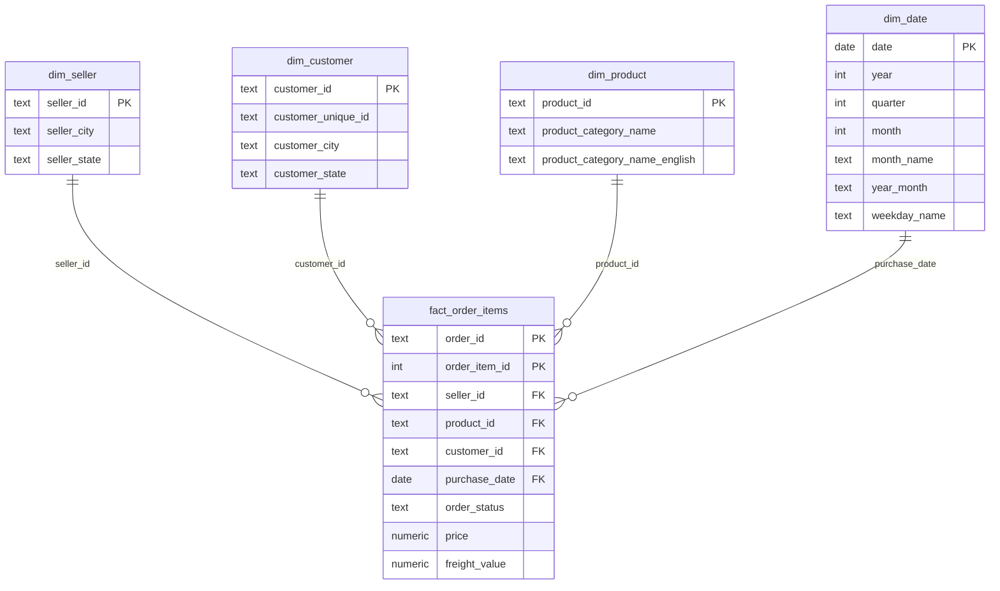

# E-commerce Analytics

An end-to-end analysis of an e-commerce dataset (orders, customers, products, payments). I load the raw data into PostgreSQL, answer business questions with SQL, model the data as a star schema, and present the findings in interactive Tableau dashboards.

## Dataset
[Brazilian E-Commerce Public Dataset by Olist (Kaggle)](https://www.kaggle.com/datasets/olistbr/brazilian-ecommerce): 99,441 orders placed from September 2016 to October 2018, in 9 CSV files.

## Tools
PostgreSQL, SQL, DBeaver, Tableau, Excel (pivot tables), Git

## Dashboards
[Olist E-commerce Analytics on Tableau Public](https://public.tableau.com/app/profile/aubakirutenov/viz/Olist_17923253755880/Orderspermonth): six charts covering orders, statuses, customers by state, payments, top sellers and price vs. freight.

## Business questions
1. How did monthly revenue and order volume change over time, and when did they peak?
2. Which product categories bring in the most revenue, and which earn the best review scores?
3. What share of customers order more than once, and does this differ by state?
4. What share of orders arrive after the estimated delivery date? How does that differ by customer state, and do late orders get lower review scores?
5. What share of revenue comes from the top 10% of sellers, and which states are those sellers in?

## Definitions
- Revenue: the sum of item prices (price in order_items), excluding shipping, for orders whose status is not canceled or unavailable.
- Order volume: the number of distinct orders, with the same status filter as revenue.
- Customer: one person, identified by customer_unique_id, because customer_id changes with every order.
- Repeat customer: a customer with more than one order, counting only orders that are not canceled or unavailable (the same filter as order volume).
- Late order: a delivered order whose actual delivery date is after its estimated delivery date. Orders with status delivered but no delivery date (8) are excluded.
- Review score: the 1-5 score in order_reviews. Category averages only include categories with at least 50 reviews.
- Top 10% of sellers: the 3,053 sellers with revenue are ranked by total revenue and split into
  10 equal groups (NTILE); the top group holds 306 sellers. 42 of the 3,095 sellers are not ranked
  because all their orders were canceled or unavailable, so they have no revenue.
- Time range: orders from 2016-09-04 to 2018-10-17. The first and last months are partial and not compared with full months.

## Data notes

### Overview
- Orders per year: 329 in 2016, 45,101 in 2017, 54,011 in 2018. The data starts in September 2016 and ends on 2018-10-17, so the years are not directly comparable.
- About 97% of orders are delivered (96,478). 625 are canceled and 609 are unavailable; both statuses are excluded from revenue.
- 29 of 3,095 sellers sold more than 500 items.
- Payment type by item (first payment per order): credit card 85,194 (about 76%), boleto 22,867 (about 20%), voucher 2,897, debit card 1,689. Orders paid in several parts are counted under their first payment type only.

### Data quality
- 8 orders are marked delivered but have no delivery date. They are excluded from late-delivery analysis.
- 1,627 of 112,650 items (1.4%) have no English category name: 1,603 have no category at all, and 24 have a Portuguese category missing from the translation table. They are kept and labeled "unknown".
- 1 delivered order (placed 2016-09-15, 3 items, 134.97) has no payment record, likely a gap from the platform's first weeks. Revenue is based on item prices, so it is still counted.
- 768 orders (about 0.8%) have no review.
- 278 customers (about 0.3%) have a zip code prefix that is missing from the geolocation table, so they cannot be placed on a map.

## Data model

The raw tables are reorganized into a star schema in a separate `mart` schema, built by `08_star_schema.sql`.

- **Grain:** one row of `fact_order_items` is one order item (order_id + order_item_id), because price and seller belong to the item, not the order.
- **Measures:** price and freight_value.
- **Dimensions:** seller, customer, product and date. The date dimension has one row per day (2016-09-01 to 2018-10-31) with year, quarter, month and weekday precomputed.
- **Order attributes:** order_id and order_status stay in the fact table instead of a separate orders table (degenerate dimensions). All statuses are kept; reports exclude canceled and unavailable orders by filtering on order_status.
- dim_customer stays at customer_id level because the address belongs to each order; people are counted with customer_unique_id.
- Products without an English category are labeled "unknown" (623 products).
- **Tests:** every dimension key is unique, no fact row is orphaned (0 for all four dimensions), joining the fact to all dimensions keeps all 112,650 rows, and revenue matches the earlier analysis to the cent (13,494,400.74).
- Payments and reviews are recorded per order, not per item, so they are not in this fact table; they would become separate fact tables at order grain.

## Key findings
### 1. Revenue trend
- Over the 20 full months (Jan 2017 – Aug 2018), revenue totals **13.45M**
  (item prices, canceled and unavailable orders excluded).
- 2017 grows almost every month, from 120K in January to a peak of **1.00M in November 2017**
  (**+52.1%** month over month, driven by Black Friday on 24 Nov), followed by a drop in December (-26.1%).
- 2018 is flat: monthly revenue stays at roughly 0.84–0.99M, with month-over-month changes
  between -13.1% and +17.1%, so growth stopped after 2017.
- Partial months (before Jan 2017 and after Aug 2018) are excluded; comparing them with full months
  would show fake jumps and a fake collapse.
  Query: `06_window_functions_v2.sql`, steps 2–3.
### 3. Repeat customers
- Only **3.0%** of customers come back: 2,888 of 94,990 placed more than one order
  (canceled and unavailable orders excluded). Most repeat customers ordered just twice (2,652).
- Among the 12 states with at least 1,000 customers, the repeat share ranges from
  **1.6% (CE) to 3.3% (RJ)**; SP, with 42% of all customers, is at 3.1%.
- No large state stands out, so low retention is a platform-wide pattern, not a regional one.
- Small states show higher shares (AC 5.2%), but these rest on a handful of customers
  and are not reliable, so states under 1,000 customers are left out of the comparison.
- Assumption: a customer who ordered from two states counts once in each.
  Query: `05_ctes_v2.sql`, step 5.
### 5. Top 10% of sellers
- The top 10% of sellers (306) bring **67.5%** of revenue (9.11M of 13.49M, all months);
  the top 20% bring 82.6%, while the bottom half of sellers brings only 3.3%.
- Top sellers sit where most sellers are: **61%** are in SP, close to SP's 60% share of all sellers.
- MG punches above its weight: 12.9% of its sellers are top sellers, against 10% overall.
  RJ (8.8%) and SC (8.6%) are slightly below.
- States with only a few sellers (e.g. MA with 1) are left out of the comparison.
  Query: `07_question5_v2.sql`, steps 2–3.

## Status
In progress, started October 2026. Sprint 2 (second round): SQL drills, CTEs and window functions
are done, and questions 1, 3 and 5 are answered in Key findings. Money columns were converted from
float to numeric for exact totals. A star schema, the remaining questions and a Tableau dashboard are next.

## Repo contents
- 00_setup.md: how the database was set up, the data loaded, and the money column type fix.
- 01_basics.sql: first queries (filtering, sorting, counts).
- 02_joins_and_aggregates.sql: joins, aggregates, GROUP BY and HAVING, NULL handling.
- 03_dates_and_grouping.sql: monthly trends, top categories, repeat customers, late deliveries.
- 04_drills.sql: drills on GROUP BY, WHERE vs. HAVING, FILTER and anti-joins (first round).
- 04_drills_v2.sql: second round of SQL drills with new tasks.
- 05_ctes.sql: CTEs and subqueries (first round).
- 05_ctes_v2.sql: subqueries and chained CTEs; answers question 3.
- 06_window_functions_v2.sql: SUM() OVER, LAG, running totals, RANK vs. ROW_NUMBER; answers question 1.
- 07_question5_v2.sql: NTILE deciles; answers question 5.
- 08_star_schema.sql: builds the star schema (4 dimensions, 1 fact table) and tests it.
- .gitignore: keeps system, Excel and data files out of the repo.
- Tableau Public workbook: six charts and a dashboard on the Olist data (link in the Dashboards section).

Sprint 2 was repeated from Oct 26 to strengthen SQL, Git and Tableau basics; `_v2` files are the second round.
